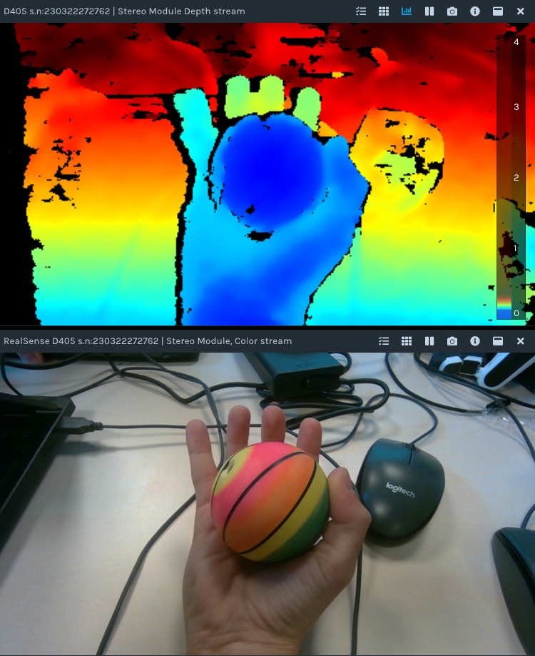
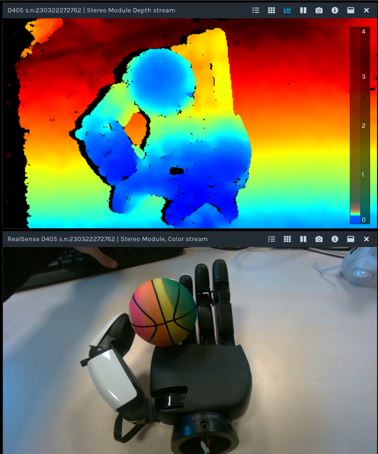
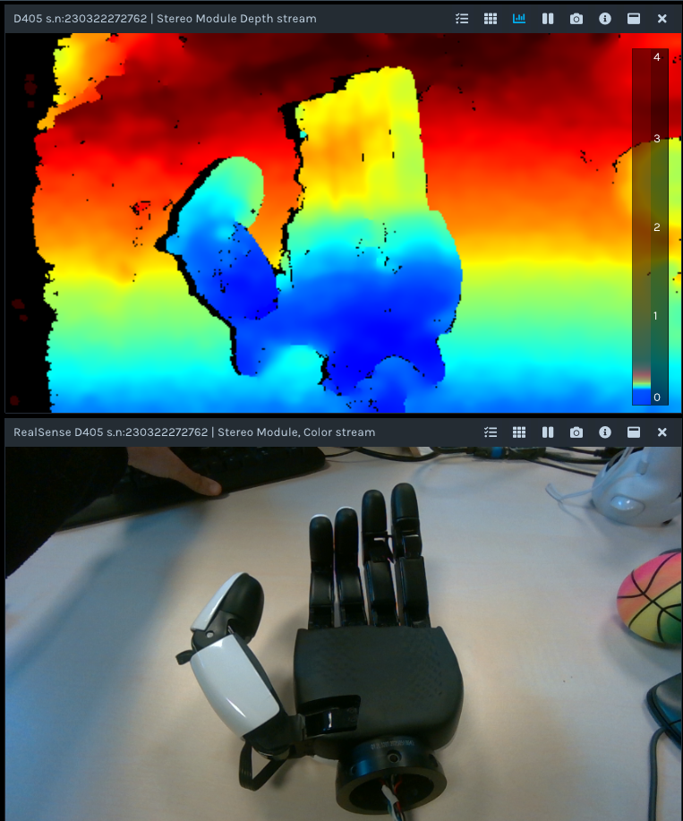
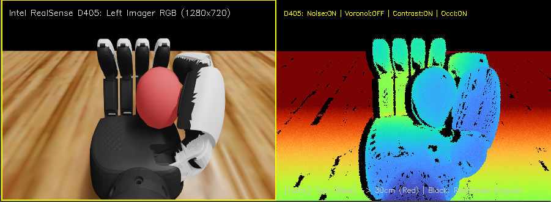
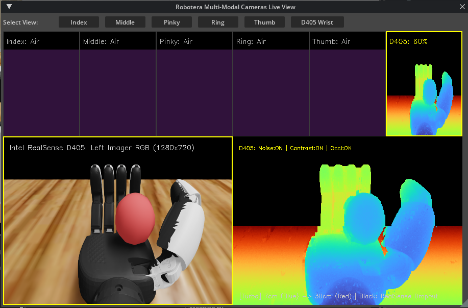

# UFactory uf850 + Robotera XHand Manipulation (Isaac Lab)

Simulation for dexterous in-hand manipulation combining the **UFactory uf850 (6-DoF arm)** with the **Robotera XHand (12-DoF dexterous hand)** in NVIDIA Isaac Lab.

> [!NOTE]
> **RealSense Camera Visualization**: To view the real-world Intel RealSense camera, ensure it is plugged into a **USB 3.0** port on the PC, then run:
> ```bash
> realsense-viewer
> ```

---

## Quick Setup

Activate your Isaac Lab environment and install the package in editable mode:

```bash
# 1. Activate conda environment
conda activate isaaclab

# 2. Install local package
pip install -e src/robotera_ball_handling
```

---

## Commands & Execution Examples

Run all commands from the repository root (`isaaclab_projects/`).

### 1. Tactile Grasp & Multi-Modal HUD

Tests dynamic hand grasping on a static ball. Displays a live OpenCV dashboard with **5 fingertip visuo-tactile heatmaps (12×10 taxel grids)** and the **Intel RealSense D405 macro depth camera with realistic stereo noise** (dropouts, occlusion shadows, edge flicker).

```bash
python src/robotera_ball_handling/scripts/test_tactile_grasp.py --enable_cameras
```

---

### 2. Arm + Hand Coordinated Movement on Table

Tests the complete **18-DoF unified robot** (6-DoF UFactory arm + 12-DoF wristless XHand) mounted on top of the table. Right now its just hardcoded movements.

```bash
# Standard run with live D405 wrist camera window
python src/robotera_ball_handling/scripts/test_arm_hand.py --enable_cameras
```

---

### 3. Individual Finger Diagnostic

Diagnostic sequence to verify joint directions, tendon limits, and PhysX sensor index mappings. Flexes and extends each physical finger for 3 seconds in order:

```bash
python src/robotera_ball_handling/scripts/test_individual_fingers.py --enable_cameras
```

---

### 4. Reinforcement Learning (NOT IMPLEMENTED YET, just template)

Starter templates for training and evaluating reinforcement learning policies on the in-hand ball rotation task:

```bash
# Launch training headless (template)
python src/robotera_ball_handling/scripts/rsl_rl/train.py --headless --num_envs 64 --max_iterations 3000

# Visualize trained policy checkpoint (template)
python src/robotera_ball_handling/scripts/rsl_rl/play.py --num_envs 1 --checkpoint /path/to/model.pt
```

---

## Common CLI Options

| Flag | Description |
| :--- | :--- |
| `--enable_cameras` | Enables rendering for tactile cameras and RealSense wrist/overview cameras |
| `--headless` | Runs simulation without opening the Isaac Sim 3D GUI window (faster, ideal for training) |
| `--device cuda:0` | Selects compute device (`cuda:0`, `cuda:1`, or `cpu`) |
| `--num_envs <N>` | Number of parallel simulation environments to spawn (e.g. `64`) |

---

## Visuals & Comparison

### Real hand view RealSense Camera


### Real Robotera hand view with a ball


### Real Robotera hand view without hand


### Depth camera simulation (with NO smoothing filter added)
DEFAULT_ENABLE_SPATIAL_FILTER = False


### Depth camera simulation (with smoothing filter added)
DEFAULT_ENABLE_SPATIAL_FILTER = True


